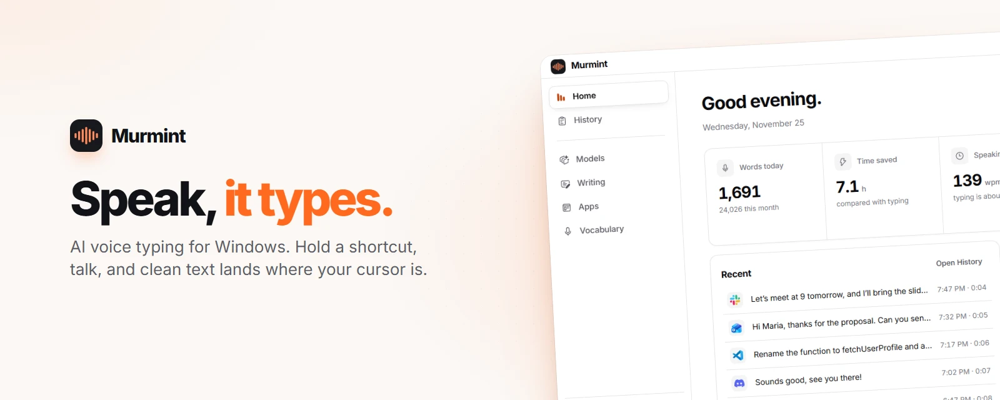
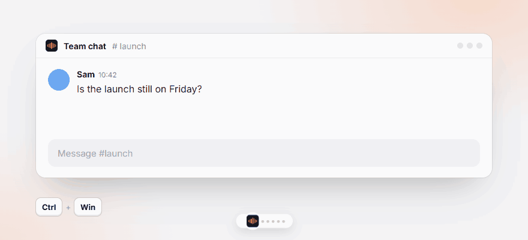
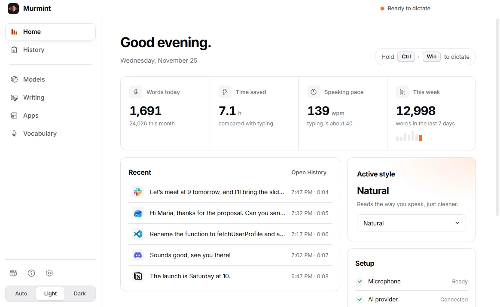
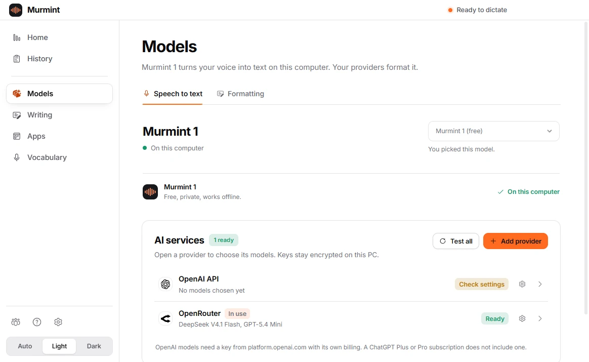
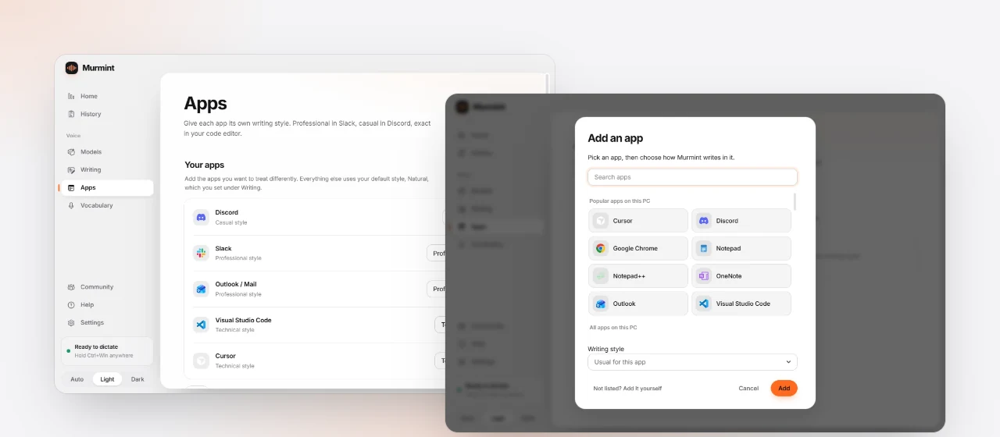
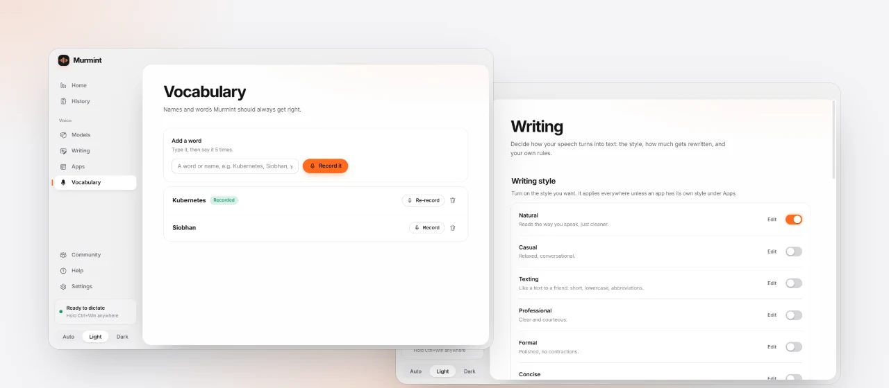
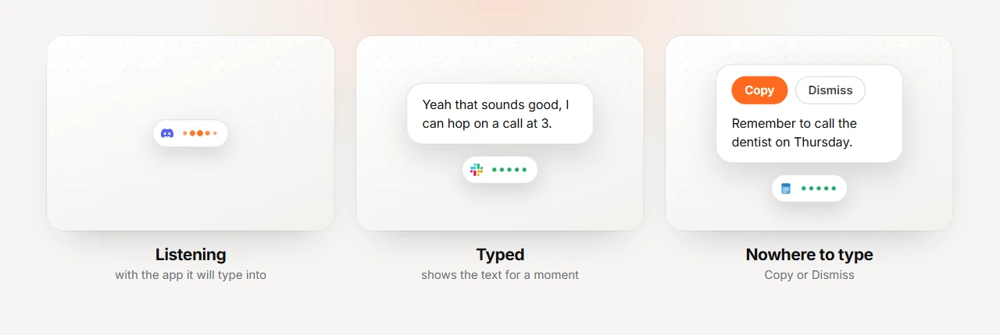

<div align="center">



[Download](https://murmint.app/download) · [Docs](https://docs.murmint.app) · [Discord](https://discord.gg/MEfdzfyARV)

</div>

> [!IMPORTANT]
> **Murmint is in closed alpha.** To use the ready-made installer, [sign up for the alpha](https://murmint.app/download) with your Discord account. You're also free to [build it yourself](#building-it-yourself) from this code. Expect bugs and changes while it's in alpha.

<br>

Hold <kbd>Ctrl</kbd>+<kbd>Win</kbd>, say what you want to say, let go. Murmint types it into whatever app you're in, without the "um"s, with the punctuation, and with the bit where you changed your mind already fixed.



Speech runs free on your own PC with Murmint 1, Murmint's own speech model. For formatting it works with whichever AI you already pay for (OpenAI, Claude, Groq, Cloudflare, Gemini, OpenRouter and others), picked automatically or by price, or a model running on your own PC.

## A look around

<table>
<tr>
<td width="50%"></td>
<td width="50%"></td>
</tr>
<tr>
<td></td>
<td></td>
</tr>
</table>



## What it's good at

Talking the way you actually talk. Pauses don't turn into full stops, and "twenty two thousand" comes out as 22,000.

It also knows where you're typing. A Slack message stays short, an email gets a greeting and a sign-off, and anything you say to ChatGPT, Claude or Cursor comes out as a tidy, numbered prompt.

## Getting started

1. Grab the installer from [murmint.app/download](https://murmint.app/download).
2. Open **Models** and paste an API key. Cloudflare and Groq both have free tiers.
3. Click into any text box, hold <kbd>Ctrl</kbd>+<kbd>Win</kbd> and talk.

Windows might show a SmartScreen warning because the installer isn't signed yet. **More info → Run anyway** gets past it.

## Building it yourself

You'll need Node.js 20+, Rust and the Visual Studio C++ build tools.

```bash
npm install
npm start       # run it
npm run dist    # make the installer
```

The heavy lifting is done by a small Rust engine in `engine/`; the Electron part only draws the windows. There's more in [how it works](docs/how-it-works.md).

## Thanks

Murmint was developed in a private repository before being opened up here. It's made by [proimpacts](https://github.com/proimpacts), who designed, directed and tested it and wrote about 60% of the code; the other 40% was written with [Claude](https://claude.com).

It stands on [nnnoiseless](https://github.com/jneem/nnnoiseless) (RNNoise) for noise reduction, [Tokio](https://tokio.rs), [reqwest](https://github.com/seanmonstar/reqwest), [Serde](https://serde.rs), [fancy-regex](https://github.com/fancy-regex/fancy-regex) and Microsoft's [windows-rs](https://github.com/microsoft/windows-rs) in the engine, [Electron](https://www.electronjs.org) for the app, [tao](https://github.com/tauri-apps/tao) and [wry](https://github.com/tauri-apps/wry) for the installer, the [Inter](https://rsms.me/inter/) font and Microsoft's [Fluent icons](https://github.com/microsoft/fluentui-system-icons).

## Models and providers

These are the models Murmint makes itself. For formatting, and for speech if you'd rather, Murmint works with the AI provider you add under **Models**, and picks **Automatic** (the best model you've set up), **Cheapest**, or the one you choose.

| Model | What it does | Status |
|---|---|---|
| **Murmint 1** | Turns your voice into text on your own PC. Free, private and works offline. Built on OpenAI's [Whisper](https://github.com/openai/whisper) Tiny, run by [whisper.cpp](https://github.com/ggml-org/whisper.cpp). | The default speech model |
| **Murmint 1 Transcription** | An earlier, separate transcription option. | Removed in 5.0 |

## License

[GPL-3.0](LICENSE)
