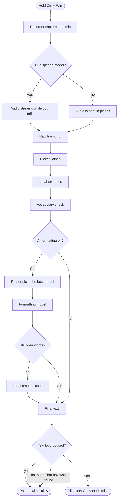
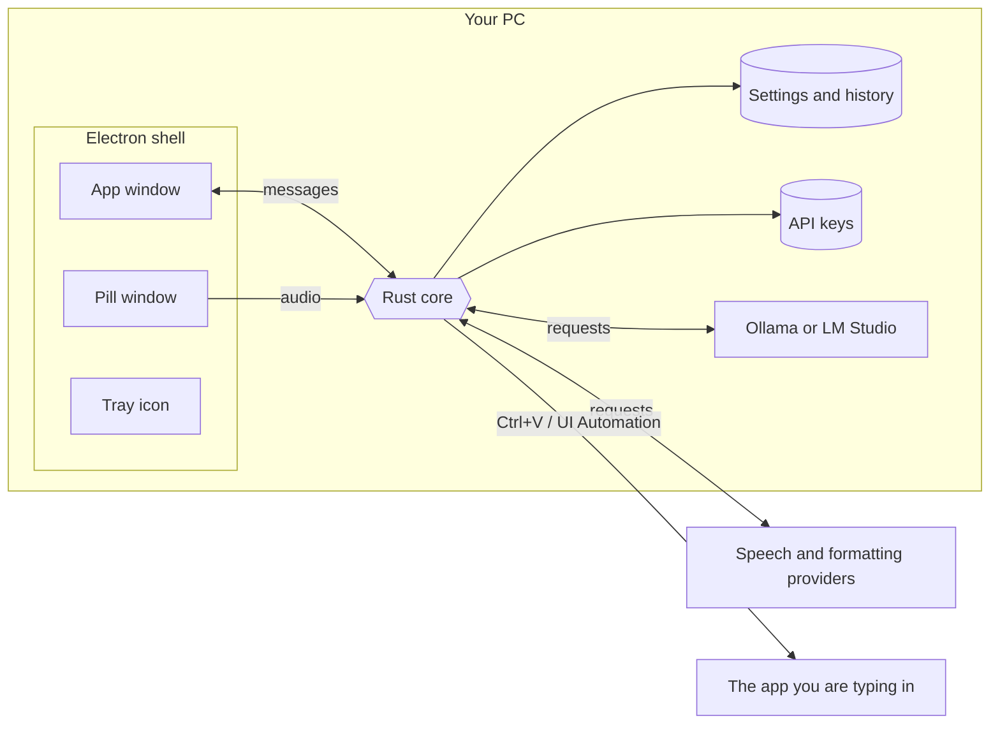

# How Murmint works

## One dictation, step by step

A few details behind the boxes:

- The recorder captures 16 kHz audio and keeps about 0.4 s from before you pressed the shortcut.
- A live speech model gets the audio over a WebSocket while you talk. Otherwise it is sent in pieces, split at natural pauses.
- When the pieces are joined, a pause under 1.6 s becomes a comma and a longer one is a possible new sentence.
- The local rules cover fillers, spoken commands, corrections, lists, punctuation and words to avoid.
- The vocabulary check applies fixed sound-alike rules first. Then the formatting model may swap in only the terms you listed.
- The router tries the best model you have set up first, speed breaks ties, and the rest are fallbacks.
- The formatting model handles grammar, layout, style and your rules. If its reply isn't your words any more, the local result is used.
- While you hold the shortcut, Murmint finds the app in front. If you added that app on the Apps page, its style, strength and notes go to the formatting model. Any other app uses your Writing style.
- The text is pasted with Ctrl+V and your clipboard is put back afterwards.

**Message context.** When this is on in Settings > Dictation, the engine reads up to 800 characters before the cursor in the focused box through Windows UI Automation, while you speak. Those characters go to the formatting model as context only, so punctuation and capitals continue from what is there. It is skipped for password fields and web pages, and it never delays the result by more than 1.5 seconds.

## What runs where

The Rust core is murmint-engine.exe, about 4.5 MB. Vocabulary and usage are saved with settings and history, API keys are encrypted with Windows (DPAPI), and Ollama or LM Studio are optional.

Everything except the interface is written in Rust. A single native process, `engine/`, is about 4.5 MB. It handles:
- dictation sessions and their states (idle, listening, processing, success, error)
- the text rules, the model router and the prompts
- vocabulary, settings, history and usage costs
- API keys and all requests to providers
- global shortcuts, window detection and typing

The interface is plain HTML, CSS and JavaScript shown by a thin Electron shell. The shell only opens the windows and the tray, records the microphone, and passes messages to and from the core.

## The pieces in the core

| Component | Description |
|---|---|
| [session.rs](../engine/src/session.rs) | The state machine for one dictation: start, pause, stop, cancel, and restart while a result is showing |
| [rt.rs](../engine/src/rt.rs) | The WebSocket connection to live transcription models |
| [text/join.rs](../engine/src/text/join.rs) | Joins pieces of a transcript and picks a comma or full stop from the pause and the words around it |
| [text/smart.rs](../engine/src/text/smart.rs), [text/local.rs](../engine/src/text/local.rs) | Fillers, lists, punctuation polish and words to avoid |
| [vocab.rs](../engine/src/vocab.rs), [vocab_ai.rs](../engine/src/vocab_ai.rs) | Sound-alike swaps, then a model pass that may only swap in your own terms |
| [profiles.rs](../engine/src/profiles.rs) | Recognises the app in front by program name or window title, and works out its style, strength and notes |
| [route.rs](../engine/src/route.rs) | Ranks the models you added, best first, with the rest as fallbacks |
| [prompt.rs](../engine/src/prompt.rs), [formatter.rs](../engine/src/formatter.rs) | Builds the cleanup prompt and rejects replies that are not your words |
| [insertion.rs](../engine/src/insertion.rs), [native.rs](../engine/src/native.rs) | Finds the focused text box, or the app's chat box, and pastes the text |
| [store.rs](../engine/src/store.rs), [usage.rs](../engine/src/usage.rs) | Settings, history, and usage and cost per model |

## Writing styles per app

When you start talking, Murmint looks at the app in front. It recognises programs by name, and a few by window title, so a Gmail tab counts as email even inside a browser. Each recognised app has a kind, such as chat, email or code, and the kind decides the layout: a greeting and sign-off in email, short lines in chat, exact names in code.

The style is up to you. The Apps page starts empty. Press Add and pick an app, then choose a style, how much gets rewritten, and any notes for that app. The list has 50 popular apps that work as soon as you add them, with their program names built in, plus the apps Murmint finds in your Start Menu and the Microsoft Store, each with its icon. Anything else can be added by choosing its program file. An app you add yourself always wins over a built-in profile for the same program.

| Situation | What Murmint uses |
|---|---|
| An app you added and gave a style | That style |
| An app you added, no style picked | The app's usual style, such as casual for Discord |
| Any other app | Your style from the Writing page |

Strength works the same way, and your notes for an app replace its built-in note. If you turn an app off, Murmint treats it like an app it doesn't know and uses your default style. The matching and the rules above live in [profiles.rs](../engine/src/profiles.rs), the page itself is [apps.js](../src/renderer/app/pages/apps.js), the popular apps are in [app-presets.js](../src/renderer/app/pages/app-presets.js), and [installed-apps.js](../src/main/installed-apps.js) finds the apps on your PC.

## How Automatic picks a model

In Automatic mode the router gives every dictation the best model you have set up, however short or long it is. Price and text length never send you to a weaker model.

| Rule | Description |
|---|---|
| Speech | English-only models are used only for English. The rest are ranked by quality. |
| Quality | Each model is Basic, Good or Best, and you can change that in its provider card. The best level goes first. |
| Speed | Between models of the same level, the one answering fastest goes first. |
| Fallbacks | If a model fails or times out, the next one takes over. |
| AI formatting off | No model is used. Only the local rules run, and nothing leaves your PC. |

The Home page shows the words you dictated, your speaking pace and the estimated cost per month.

[Back to the README](../README.md)
